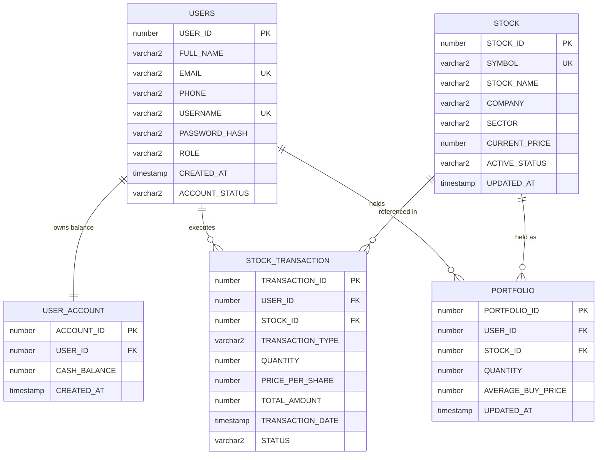

# Stock Market Management System

**A Laboratory Information System & Simulation Engine for Academic DBMS Studies**  
Built with **HTML5, Vanilla CSS3, JavaScript, Java Servlets (javax.servlet), JDBC, Apache Tomcat 9, and Oracle Database**.

---

## 1. Project Abstract

The **Stock Market Management System** is an enterprise-patterned web application developed for college Database Management Systems (DBMS) laboratory curricula. The system models a securities exchange and retail brokerage clearinghouse. Users can register trader accounts, manage simulated cash balances, browse real-time equity listings, execute atomic buy and sell market orders with strict concurrency controls, track live portfolio valuations, and generate comprehensive financial audit reports.

The backend leverages Java Servlets with JDBC connected to Oracle Database 11g/19c/21c via SQL*Plus. The application architecture enforces ACID compliance, prevents race conditions using database row-level locking (`SELECT ... FOR UPDATE`), encrypts credentials using BCrypt blowfish hashing, and delivers a sleek dark navy-blue financial dashboard styled with pure CSS3 and Chart.js.

---

## 2. Problem Statement

Financial and securities systems represent one of the most demanding domains in database management. Traditional academic student projects often simulate database interactions using superficial frontend code or non-concurrent databases without handling:
1. **Concurrency Conflicts:** Simultaneous orders attempting to buy or sell the same holdings or balance.
2. **Negative Balances & Phantom Shares:** Selling shares a user does not own or spending more cash than available.
3. **Double-Counting Distortions:** Confusing gross transaction volume with net portfolio holdings.
4. **Security Vulnerabilities:** Plaintext password storage and SQL injection vulnerabilities.

This project addresses these critical challenges by implementing a production-grade database schema in Oracle with sequences, triggers, foreign key cascade constraints, row-locking transactions, and server-side validation.

---

## 3. Objectives

- Design an Oracle Database relational schema adhering to Boyce-Codd Normal Form (BCNF).
- Implement atomic trade order execution using JDBC transactions with explicit commit and rollback boundaries.
- Employ row-level pessimistic locking (`FOR UPDATE`) to ensure consistency during concurrent buy and sell orders.
- Secure trader accounts with BCrypt salted password hashing and role-based session filtering.
- Provide a responsive dark-themed trading dashboard featuring dynamic financial charts and instant order receipt vouchers.
- Demonstrate comprehensive SQL operations: DDL, DML, multi-table JOINs, subqueries, and aggregate analytical reports.

---

## 4. Scope

- **In Scope:**
  - Multi-user authentication and session management.
  - Virtual cash deposits for simulated trading.
  - Active market directory with search and sector filtering.
  - Buy and sell market order execution with receipt vouchers.
  - Dynamic user portfolio with weighted-average cost basis and unrealized profit/loss.
  - Transaction history filtering (symbol, type, date).
  - Financial statements calculating realized and unrealized capital gains.
  - Administrator stock directory management (add, edit, toggle active status).
- **Out of Scope:**
  - Real-world monetary payment gateway integration (strictly simulated trading).
  - Live third-party stock exchange REST API feeds (uses Oracle database demonstration equities).
  - Margin trading, short selling, and derivatives options.

---

## 5. System Features

1. **Enterprise Security & Authentication:**
   - Mandatory registration validation (email regex, password confirmation).
   - BCrypt Blowfish hashing (`$2a$10$...`) with secure random salting.
   - Session hijacking protection via servlet session invalidation upon login/logout.
   - Authentication filter (`AuthFilter`) intercepting unauthorized requests.
2. **Atomic Trade Order Engine:**
   - Price verification directly against the Oracle database on the server (never trusting browser input).
   - Row-locking on user cash balance and portfolio records.
   - Automatic weighted-average buy price calculation on multiple purchases.
   - Comprehensive rollback on overdrafts or insufficient shares.
3. **Audited Transaction Logging & Receipts:**
   - Every buy, sell, and deposit generates an immutable audit entry in `STOCK_TRANSACTION`.
   - Pop-up voucher receipt with unique Transaction ID, timestamp, and pricing breakdown.
4. **Interactive Financial Visualizations:**
   - Market share prices bar chart.
   - Portfolio asset allocation doughnut chart.
   - Historical cash flow vs. net return comparisons.
5. **Role-Based Administrator Module:**
   - Dedicated tools for administrators (`role = 'ADMIN'`) to list all equities, introduce new stocks, edit market prices, and toggle active status.

---

## 6. Software and Hardware Requirements

### Software Requirements
- **Operating System:** Windows 10 / 11 (64-bit)
- **Java Development Kit:** JDK 11 or compatible version with Apache Tomcat 9 (e.g. JDK 11, 17, 21, 27)
- **Servlet Container / Web Server:** Apache Tomcat 9.0.x
- **Database Server:** Oracle Database 11g XE / 18c / 19c / 21c
- **Database Client:** Oracle SQL*Plus
- **JDBC Driver:** Oracle JDBC Thin Driver (`ojdbc11.jar` / `ojdbc8.jar` / `ojdbc6.jar`)
- **Web Browser:** Google Chrome, Microsoft Edge, or Mozilla Firefox

### Hardware Requirements
- **Processor:** 1.8 GHz dual-core or faster (64-bit)
- **Memory (RAM):** 4 GB minimum (8 GB recommended for running Oracle DB + Tomcat simultaneously)
- **Storage:** 2 GB free disk space for Oracle XE binaries, Tomcat, and project code

---

## 7. Architecture

The application adheres to a clean **3-Tier Model-View-Controller (MVC)** architecture:

```
┌──────────────────────────────────────────────────────────┐
│                   PRESENTATION TIER                      │
│   HTML5 • Vanilla CSS3 (Dark Navy) • JavaScript • Chart.js│
│       [dashboard.html] [stocks.html] [portfolio.html]    │
└────────────────────────────┬─────────────────────────────┘
                             │ HTTP JSON / REST API Requests
                             ▼
┌──────────────────────────────────────────────────────────┐
│                   APPLICATION LOGIC TIER                 │
│              Apache Tomcat 9 • Java Servlets             │
│   AuthServlet • TransactionServlet • StockServlet        │
│   DashboardServlet • ReportsServlet • AuthFilter         │
│             Data Access Objects (DAO Layer)              │
│   UserDAO • StockDAO • TransactionDAO • PortfolioDAO     │
└────────────────────────────┬─────────────────────────────┘
                             │ JDBC Thin Driver (ojdbc)
                             ▼
┌──────────────────────────────────────────────────────────┐
│                    DATA STORAGE TIER                     │
│                Oracle Database (SQL*Plus)                │
│    USERS • USER_ACCOUNT • STOCK • PORTFOLIO • TXN        │
│     Pessimistic Row Locks (FOR UPDATE) • Sequences       │
└──────────────────────────────────────────────────────────┘
```

---

## 8. Database Schema & Entity Relationships

The schema is organized into five core normalized tables:



---

## 9. Explanation of DDL and DML Commands

- **Data Definition Language (DDL):**
  - `CREATE SEQUENCE`: Generates sequential integers (`USER_SEQ`, `STOCK_SEQ`, `TXN_SEQ`).
  - `CREATE TABLE`: Defines relational tables, primary keys, check constraints, and foreign keys.
  - `CREATE TRIGGER`: Enforces automatic population of primary keys using `seq.NEXTVAL` on row insert.
  - `CREATE INDEX`: Optimizes search and multi-table join lookups on `USERNAME`, `EMAIL`, `SYMBOL`, and `USER_ID`.
  - `DROP TABLE ... CASCADE CONSTRAINTS`: Safely removes existing schema objects during teardown.
- **Data Manipulation Language (DML):**
  - `INSERT INTO`: Inserts new user registrations, trade orders, and stock directory listings.
  - `SELECT ... FOR UPDATE`: Locks candidate rows to serialize concurrent trade operations.
  - `UPDATE`: Adjusts cash balances, portfolio quantities, and stock market prices.
  - `DELETE`: Clears portfolio holding records when an investor liquidates 100% of their shares.
  - `COMMIT` & `ROLLBACK`: Controls database transaction boundaries for ACID atomicity.

---

## 10. Important SQL Queries

### A. DDL: Table Creation with Constraints
```sql
CREATE TABLE PORTFOLIO (
    PORTFOLIO_ID      NUMBER(10)        NOT NULL,
    USER_ID           NUMBER(10)        NOT NULL,
    STOCK_ID          NUMBER(10)        NOT NULL,
    QUANTITY          NUMBER(10)        DEFAULT 0 NOT NULL,
    AVERAGE_BUY_PRICE NUMBER(12, 2)     DEFAULT 0.00 NOT NULL,
    UPDATED_AT        TIMESTAMP         DEFAULT CURRENT_TIMESTAMP NOT NULL,
    CONSTRAINT PK_PORTFOLIO PRIMARY KEY (PORTFOLIO_ID),
    CONSTRAINT UQ_USER_STOCK UNIQUE (USER_ID, STOCK_ID),
    CONSTRAINT FK_PORTFOLIO_USER FOREIGN KEY (USER_ID) REFERENCES USERS(USER_ID) ON DELETE CASCADE,
    CONSTRAINT FK_PORTFOLIO_STOCK FOREIGN KEY (STOCK_ID) REFERENCES STOCK(STOCK_ID) ON DELETE CASCADE,
    CONSTRAINT CHK_PORTFOLIO_QTY CHECK (QUANTITY >= 0)
);
```

### B. DML: Insertion
```sql
INSERT INTO STOCK (SYMBOL, STOCK_NAME, COMPANY, SECTOR, CURRENT_PRICE, ACTIVE_STATUS) 
VALUES ('NVDA', 'NVIDIA Corporation', 'NVIDIA Corporation', 'Semiconductors', 875.40, 'ACTIVE');
```

### C. DML: Row-Level Concurrency Locking
```sql
-- Lock user account to prevent race condition during buy order
SELECT CASH_BALANCE FROM USER_ACCOUNT WHERE USER_ID = 1002 FOR UPDATE;
```

### D. Multi-Table JOIN: Live User Portfolio Valuation
```sql
SELECT 
    p.PORTFOLIO_ID,
    s.SYMBOL,
    s.COMPANY,
    s.SECTOR,
    p.QUANTITY,
    p.AVERAGE_BUY_PRICE,
    s.CURRENT_PRICE,
    (p.QUANTITY * p.AVERAGE_BUY_PRICE) AS TOTAL_COST,
    (p.QUANTITY * s.CURRENT_PRICE) AS CURRENT_VALUE,
    ((p.QUANTITY * s.CURRENT_PRICE) - (p.QUANTITY * p.AVERAGE_BUY_PRICE)) AS UNREALIZED_PL
FROM PORTFOLIO p
JOIN STOCK s ON p.STOCK_ID = s.STOCK_ID
WHERE p.USER_ID = 1002 AND p.QUANTITY > 0
ORDER BY s.SYMBOL ASC;
```

### E. GROUP BY & Aggregates: Order History Audit
```sql
SELECT 
    TRANSACTION_TYPE,
    COUNT(*) AS TOTAL_ORDERS,
    SUM(TOTAL_AMOUNT) AS TOTAL_VOLUME,
    AVG(TOTAL_AMOUNT) AS AVERAGE_ORDER_VALUE
FROM STOCK_TRANSACTION
WHERE USER_ID = 1002 AND STATUS = 'COMPLETED'
GROUP BY TRANSACTION_TYPE;
```

### F. Subquery: Top Traded Securities
```sql
SELECT SYMBOL, COMPANY, CURRENT_PRICE
FROM STOCK
WHERE STOCK_ID IN (
    SELECT STOCK_ID 
    FROM STOCK_TRANSACTION 
    GROUP BY STOCK_ID 
    HAVING COUNT(*) > 5
);
```

---

## 11. Installation & Execution Summary

1. Execute the database script in Oracle SQL*Plus:
   ```cmd
   sqlplus SYSTEM/oracle@//localhost:1521/xe @database/stock_market.sql
   ```
2. Build the application using the automated Windows batch script:
   ```cmd
   build.bat
   ```
3. Start Apache Tomcat:
   ```cmd
   C:\apache-tomcat-9.0.123-windows-x64\apache-tomcat-9.0.123\bin\startup.bat
   ```
4. Access the web application:
   ```
   http://localhost:8080/StockMarketManagement/
   ```
*(For complete step-by-step instructions, see [`SETUP_GUIDE.md`](file:///C:/Users/sanja/.gemini/antigravity-ide/scratch/StockMarketManagement/SETUP_GUIDE.md)).*

---

## 12. Test Plan & Evaluation Matrix

| Test ID | Test Scenario | Input Data | Expected Output | Status |
|---|---|---|---|---|
| **TC-01** | Successful User Registration | Name: "Alice", Email: "alice@test.com", Username: "alice", Pass: "Pass@123" | User created; auto-allocated $10,000 demo cash; redirect to login | Verified |
| **TC-02** | Duplicate Username Rejection | Username: "alice" (already existing) | HTTP 409 Conflict: "Username already taken" | Verified |
| **TC-03** | Duplicate Email Rejection | Email: "alice@test.com" (existing) | HTTP 409 Conflict: "Email already exists" | Verified |
| **TC-04** | Invalid Password Attempt | Username: "admin", Password: "WrongPassword" | HTTP 401: "Invalid username or password" | Verified |
| **TC-05** | Successful Administrator Login | Username: "admin", Password: "Admin@123" | HTTP 200; Session created; redirect to dashboard; Admin menu visible | Verified |
| **TC-06** | Unauthenticated Page Access | Direct GET to `dashboard.html` without session cookie | HTTP 302 Redirect to `login.html` | Verified |
| **TC-07** | Successful Cash Deposit | Deposit Amount: $5,000 | Balance incremented by $5,000; DEPOSIT logged in `STOCK_TRANSACTION` | Verified |
| **TC-08** | Negative Deposit Amount | Deposit Amount: -$500 | HTTP 400: "Deposit amount must be greater than zero" | Verified |
| **TC-09** | Valid Stock Purchase | Stock: AAPL (10 shares @ $178.50) | Total $1,785 deducted; 10 shares in portfolio; receipt voucher generated | Verified |
| **TC-10** | Purchase with Insufficient Cash | Available: $100, Order Total: $1,785 | Transaction aborted; HTTP 400: "Insufficient cash balance" | Verified |
| **TC-11** | Valid Stock Sale | Owned: 10 AAPL, Sell: 4 AAPL | 4 shares removed; cash credited; receipt voucher issued | Verified |
| **TC-12** | Sale Exceeding Owned Shares | Owned: 6 AAPL, Sell: 10 AAPL | Transaction aborted; HTTP 400: "Cannot sell 10 shares, only own 6" | Verified |
| **TC-13** | Inactive Stock Purchase Attempt | Stock: INTC (Status: INACTIVE) | Order rejected; HTTP 400: "Trading for INTC is currently suspended" | Verified |
| **TC-14** | Portfolio Weighted Cost Calculation | Buy 10 @ $100, then buy 10 @ $200 | Avg buy price calculated as $150.00 | Verified |
| **TC-15** | Order History Filtering | Filter by symbol: "AAPL", Type: "BUY" | Table displays only BUY transactions for AAPL | Verified |
| **TC-16** | Session Invalidation on Logout | Click "Sign Out" | HTTP Session destroyed; browser back button cannot access dashboard | Verified |
| **TC-17** | SQL Injection Mitigation | Username: `' OR '1'='1` | Handled safely by `PreparedStatement`; login safely rejected | Verified |

---

## 13. Limitations

- Real market prices fluctuate dynamically via financial market APIs; the current system relies on educational market prices stored in Oracle Database.
- High-frequency limit orders and stop-loss triggers are not implemented in the current laboratory version.

---

## 14. Future Enhancements

- Integration with WebSockets for real-time live price streaming without page refresh.
- Advanced candlestick charting (OHLC data: Open, High, Low, Close).
- Watchlist and price alert email notifications.
- Corporate actions support (dividend payouts and stock splits).

---

## 15. Conclusion

The **Stock Market Management System** provides a complete, robust, and pedagogically rich implementation of a modern financial database application. By combining Oracle Database's enterprise concurrency features with clean Java Servlets and a modern dark navy UI, the project serves as an ideal benchmark for college DBMS laboratory evaluations and viva examinations.
